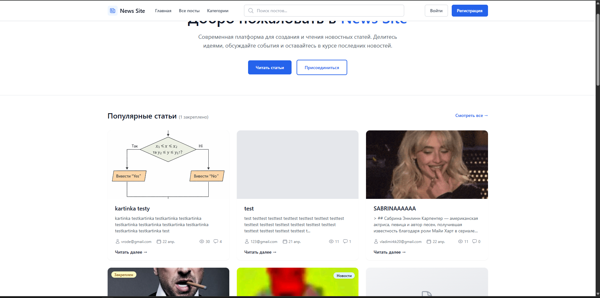

# APP-NEWS

**APP-NEWS** is a full-stack news community platform built with Django and Vue. Users can publish news, interact with subscriptions, use Stripe payments, receive email notifications, and explore content through a REST API.

**Live demo:** https://app-news-2-74rz.onrender.com/



## Tech Stack

**Backend**

- Python
- Django
- Django REST Framework
- Celery
- Redis
- PostgreSQL
- Stripe
- JWT authentication

**Frontend**

- Vue 3
- Vite
- HTMX

**Infrastructure**

- Docker
- Docker Compose
- Render

## Features

- News and post publishing
- Custom user model and authentication
- JWT-based REST API
- Stripe checkout and subscription payments
- Stripe webhook processing
- Subscription expiration handling
- Celery background tasks
- Redis task queue
- Email notifications
- Vue-based frontend and Django backend

## Architecture

The project is split into separate backend and frontend directories:

```text
app-news/
├── backend/       # Django REST API and business logic
├── frontend/      # Vue 3 application
├── docker-compose.yml
└── image.png
```

PostgreSQL stores application data, Redis provides the Celery broker and asynchronous task infrastructure, and Stripe webhooks are used to synchronize payment state.

## Running Locally

### Prerequisites

- Docker
- Docker Compose
- Stripe account for payment-related features

### Start the application

```bash
git clone https://github.com/AAAArtteem21/app-news.git
cd app-news
cp backend/.env.example backend/.env
docker compose up --build
```

Update `backend/.env` with your Django secret, database, Redis, email, and Stripe credentials.

## Development

### Backend

```bash
cd backend
python -m venv .venv
source .venv/bin/activate
pip install -r requirements.txt
python manage.py migrate
python manage.py runserver
```

### Frontend

```bash
cd frontend
npm install
npm run dev
```

## API

The backend exposes a REST API built with Django REST Framework and JWT authentication. API endpoints cover users, posts, subscriptions, and payment-related workflows.

## Roadmap

- Add detailed API documentation
- Expand automated test coverage
- Add CI checks for tests, linting, and migrations
- Improve responsive layout
- Add screenshots for key workflows
- Add contributor and deployment documentation

## Repository

- **Live demo:** https://app-news-2-74rz.onrender.com/
- **Source code:** https://github.com/AAAArtteem21/app-news
